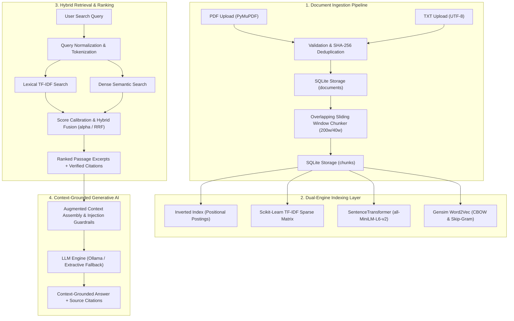

# System Architecture: AI-Powered Semantic Search Engine

## 1. Executive Architecture Overview

The **AI-Powered Semantic Search Engine** is an end-to-end information retrieval and generative question-answering system. It bridges classical lexical information retrieval (TF-IDF, Inverted Index) and modern transformer-driven neural techniques (Dense Semantic Embeddings, Scaled Dot-Product Self-Attention, and Retrieval-Augmented Generation).

---

## 2. Component Breakdown

### 2.1 Ingestion & Document Processing (`services/document_processor.py`)
- **PyMuPDF Engine (`pymupdf`)**: Extracts raw text page-by-page from arbitrary PDFs, maintaining origin page numbers for citation tracking.
- **Deduplication Engine**: Calculates the SHA-256 checksum of every uploaded byte stream. Duplicate uploads are flagged instantly without re-processing.
- **Sliding-Window Chunker**: Divides multi-page text into 200-word passages with a 40-word overlap. Overlap guarantees that sentences spanning page or chunk boundaries do not lose contextual meaning.

### 2.2 Dual Retrieval Layer
- **Lexical Engine (`services/tfidf_search.py` & `services/inverted_index.py`)**:
  - `InvertedIndex`: Maps vocabulary terms to posting lists recording chunk IDs, term frequencies (TF), and positional offsets.
  - `TfidfSearchService`: Fits a sublinear TF-IDF vectorizer over the corpus and computes cosine similarity against the sparse query vector.
- **Dense Semantic Engine (`services/embeddings_service.py`)**:
  - Leverages `sentence-transformers/all-MiniLM-L6-v2` (384-dimensional dense vectors) to capture latent conceptual meaning and overcome vocabulary mismatch.
  - Features a persistent binary cache (`cache/chunk_embeddings_cache.npz`) for instant restart times.
  - Features an automatic LSA (Latent Semantic Analysis) fallback projector if network/HuggingFace access is unavailable.

### 2.3 Hybrid Ranking & Fusion (`services/hybrid_search.py`)
- **Linear Combination**:
  $$\text{FinalScore} = \alpha \cdot \text{NormalizedKeyword} + (1 - \alpha) \cdot \text{NormalizedSemantic}$$
  Min-Max normalization ensures calibrated combination across heterogeneous score distributions.
- **Reciprocal Rank Fusion (RRF)**:
  $$\text{RRF\_Score}(d) = \sum_{m \in \{\text{lexical}, \text{semantic}\}} \frac{1}{k_{\text{rrf}} + \text{rank}_m(d)}$$
  Default smoothing constant $k_{\text{rrf}} = 60$.

### 2.4 Generative RAG & Security Guardrails (`services/llm_service.py`)
- Constructs strict prompt isolation using `<CONTEXT>` tags to mitigate indirect prompt injection from third-party documents.
- Features multi-backend support: Local Ollama (`llama3.2`), OpenAI-compatible endpoints, and an intelligent rule-based Extractive Fallback QA engine that requires zero network access.
- Implements strict citation verification: every generated claim is tied to its originating document title and page number.

### 2.5 Unsupervised Clustering & Attention Inspection
- **K-Means & PCA (`services/clustering_service.py`)**: Clusters documents in either TF-IDF or Dense Embedding feature spaces, extracts centroid topic keywords, projects points to 2D via PCA, and calculates the Silhouette Score.
- **Attention Heatmaps (`services/attention_service.py`)**: Extracts multi-head self-attention matrices ($A = \text{softmax}(QK^T / \sqrt{d_k})$) across selectable layers and heads, outputting base64-encoded Matplotlib heatmaps.
